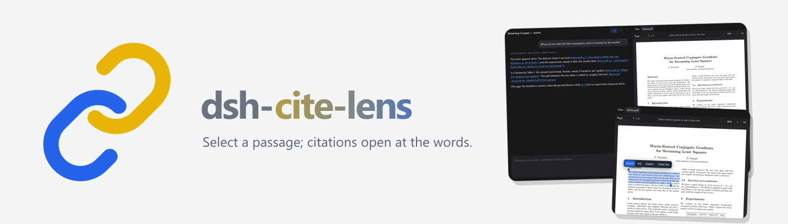
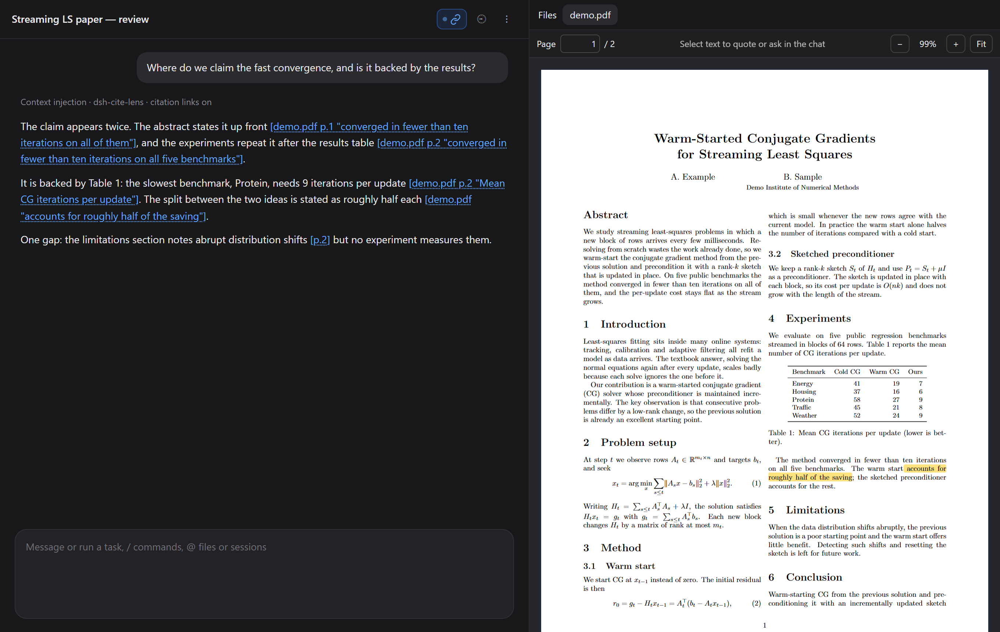
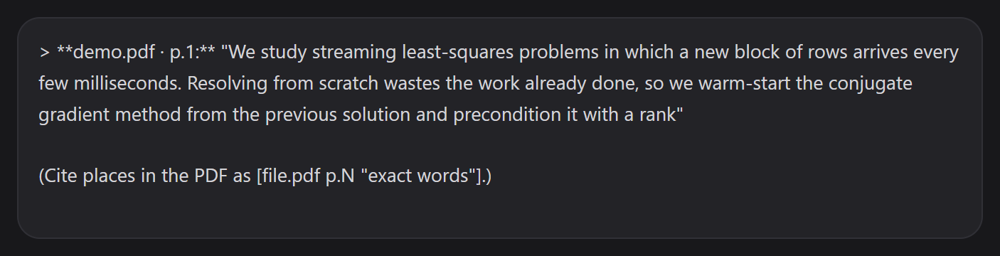
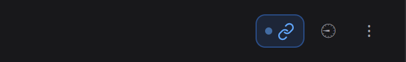

<picture>
  <source media="(prefers-color-scheme: dark)" srcset="assets/banner-dark.png">
  
</picture>

<br>

# dsh-cite-lens

[English](README.md) | 中文

     

一个 [DeepSeek Harness](https://github.com/deepseek-ai/deepseek-harness) 插件：就在你已经打开的 PDF 里，和模型一起改论文。

- **在 PDF 里选中文字，就它提问。** **Files** 标签页里的 PDF 以可选中的文字打开。选中一段话，把它发到当前这个对话里——带引用，并标上文件和页码。
- **点模型的引用就能跳过去。** 当模型写出 `[main.pdf p.7 "exact words"]` 这样的引用时，它就是一个链接：点一下会打开 PDF、滚到那几句话，并用一层渐隐的标记高亮它们。
- **`/cite-links`** 让这个对话里关于论文的**每一句**都带上这样的链接——审稿时很好用，也能用来核对模型改了你的 LaTeX 之后到底改了什么。

**一切都留在你自己的机器上。** PDF 用 [PDF.js](https://mozilla.github.io/pdf.js/) 在你的浏览器里渲染，不上传任何东西；插件本身从不发送消息——它只往你的输入框里填内容。



## 安装

```sh
dsh plugin --profile web add dsh-cite-lens
```

重启 `dsh web`。此后从 **Files** 标签页打开的 PDF 都走 Cite Lens。想回到 dsh 内置的 PDF 视图，把插件移除即可。

## 你会得到什么

### 选中一段话，就它提问

选中文字后，上方会出现一条工具栏：

| 按钮 | 放进你输入框的内容 |
| --- | --- |
| **Quote**（引用） | 那段话，标上 `main.pdf · p.17`，留给你在下面接着写 |
| **Ask**（提问） | 那段话，光标停在 `Question:` 之后 |
| **Explain**（解释） | 那段话，外加一句请它解释的要求 |
| **Check this**（核对） | 那段话，外加一句请它对照论文核对论点的要求 |

每一样都追加在**你已经打的内容下面**，并且落在你当前所在的对话里。你不发送，它就不会发出去。




这里的选中行为像编辑器，而不像 PDF 的原始文字层：

- 光标划过行间空隙或页边时，不会一下子跳到整页；
- 两端的**手柄**可以把选区拉长或缩短，并对齐到最近的字；
- **Shift+点击**扩展或收缩选区；**Shift+←/→** 按字符移动末端，**Shift+Alt+←/→** 按词移动。

### 能打开 PDF 的引用

插件会往每个对话的系统提示里加一小段说明，告诉模型这套引用格式，于是它可以这样指向具体位置：

| 模型写 | 点它会 |
| --- | --- |
| `[p.7]` | 你正在读的那个 PDF 的第 7 页 |
| `[main.pdf p.7]` | 打开 `main.pdf`（或切过去）到第 7 页 |
| `[main.pdf "exact words"]` | 打开它，在整个 PDF 里找到这些词并高亮 |
| `[main.pdf p.7 "exact words"]` | 同上，先在第 7 页里找 |

页码是故意做成可选的：模型改过你的 LaTeX 之后，很少知道某句话落在了哪一页，所以它引原话，由 Cite Lens 去找。匹配很宽容——换行、跨行连字符、连字（ligature）、弯引号和大小写都会被忽略——而且对还没画出来的页也有效。如果 PDF 里没有这些词（比如改动之后还没重新编译），链接会告诉你，而不是跳到错误的地方。

路径相对于对话的工作区（`[build/main.pdf "…"]`）。没有打开的 PDF 会通过 dsh 的 Files 标签页打开。什么都没打开时，一个光秃秃的 `[p.7]` 会重新打开你上次用过的 PDF。

### `/cite-links`

```
/cite-links          本对话开 / 关
/cite-links on|off   直接设定
/cite-links status   查看状态
```

打开期间，你发出的每条消息都会附带一段简短提醒，要求模型把关于论文的每条陈述都用链接支撑起来——正文、列表和表格都一样。对话顶栏上的一个链接图标显示当前状态（开启时带一个圆点），点一下即可切换。这个设置按对话保存，重启后仍然有效。



## 环境要求

- dsh `0.1.5-rc.2` 或更新的版本，**web** profile（`dsh web`）。开发基于 0.1.5 线，并在 `0.2.1-rc.3` 上核对过：PDF 预览以外部队列（external band）的渲染器注册，并声明 `binaryExtensions: ['pdf']`，这是两条线共有的契约。
- Node.js 22 或更新版本
- 一个较新的浏览器。引用的下划线用 CSS Custom Highlight API 绘制；在不支持它的浏览器里，链接照样能点，只是没有下划线。已在 Chrome 中测试。

## 工作原理

| 部分 | 用到的 dsh 接口 |
| --- | --- |
| PDF 视图 | `ctx.documentPreviews.register({ extensions: ['pdf'], priority: 'extension' })` 与带 key 的 `sidebar.right.tab.document` 插槽——外部队列排在内置视图之前 |
| 写入你的输入框 | 当前对话（`ctx.sessions.list`）→ 它的 scope（`ctx.sessions.scope`）→ `ctx.conversation.input.for(scope)`：读取草稿并追加，从不替换，也从不在一句话正在发送时去动它 |
| 打开被引用的 PDF | `ctx.sidebarRight.openResource(address)` |
| 引用链接 | 用 `::highlight()` 上色的文本范围，点击时做命中测试——对话的 DOM 从不被修改，所以流式回复不受影响 |
| 引用说明 | 每个对话系统提示里的一节（`agent/session-start`） |
| `/cite-links` | 一个 dsh 命令；开启期间，提醒会附在承载你新提示的那一步上（`agent/pre-step`），每条提示一次 |

长论文上的渲染依然顺滑：页面按离你阅读位置最近优先、一页一页地画，先 1× 起手，滚动停止后再变清晰；远处页面会被释放；文字层在空闲时间里构建。

## 开发

```sh
npm install      # PDF.js 和 esbuild（仅开发用——运行时没有依赖）
npm run build    # src/client → lib/client.js
npm test         # 引用、写入对话、引用解析、/cite-links、PDF.js 取文字
```

`lib/client.js` 是生成的：改 `src/client/`，然后重新构建。它打包了 PDF.js（Apache-2.0）及其 worker，所以插件不需要任何静态文件路由。

## 许可

MIT——见 [LICENSE](LICENSE)，其中也包含随包分发的 PDF.js 的声明。
