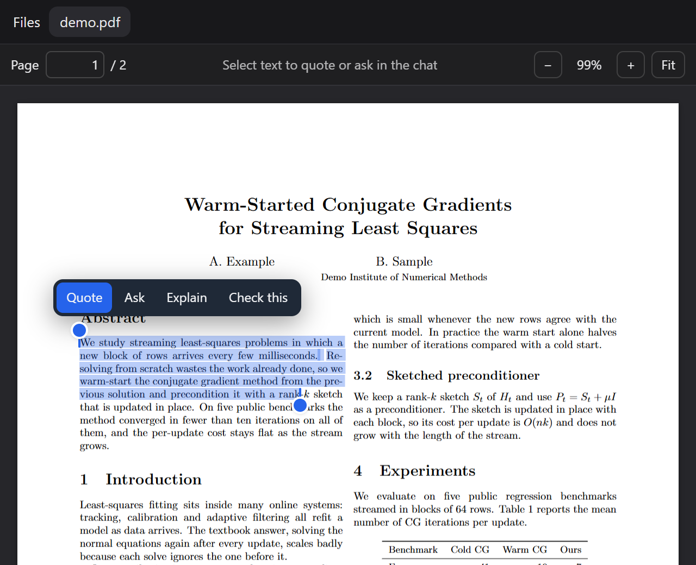

# dsh-cite-lens

A [DeepSeek Harness](https://github.com/deepseek-ai/deepseek-harness) plugin for working on papers with the model. Select text in a PDF to quote or ask about it in the chat you are in, and click the model's citations — `[main.pdf p.7 "exact words"]` — to land on the passage, highlighted.

[View on GitHub](https://github.com/adithyanraj03/dsh-cite-lens){: .btn }

   


---

## Install

```sh
dsh plugin --profile web add dsh-cite-lens
```

Restart `dsh web`. PDFs opened from the **Files** tab now use Cite Lens.

## Select a passage, ask about it

Select text and choose **Quote**, **Ask**, **Explain** or **Check this**. The passage goes into your message box, tagged with the file and page, under whatever you have already typed. Nothing is sent until you send it.




Handles at both ends grow or shrink the selection; Shift+click and Shift+arrows work as in an editor.

## Citations that open the PDF

The model is told how to cite, and every citation becomes a link:

- `[main.pdf "exact words"]` — opens the PDF, finds the words, highlights them;
- `[main.pdf p.7 "exact words"]` — the same, searching page 7 first;
- `[p.7]` — a page of the PDF you are reading.

The page is optional, so after editing your LaTeX the model can point at the changed sentence without knowing where it lands. Line breaks, hyphenation, ligatures and quote styles are forgiven. Text that is not in the PDF yet (not rebuilt) is reported, not guessed.

## `/cite-links`

Turns on citations for every answer in a chat: each message you send carries a short reminder to back every claim about the paper with a link. A link icon in the top bar shows the state and toggles it.


---

MIT licensed. PDF rendering by [PDF.js](https://mozilla.github.io/pdf.js/) (Apache-2.0), bundled.
